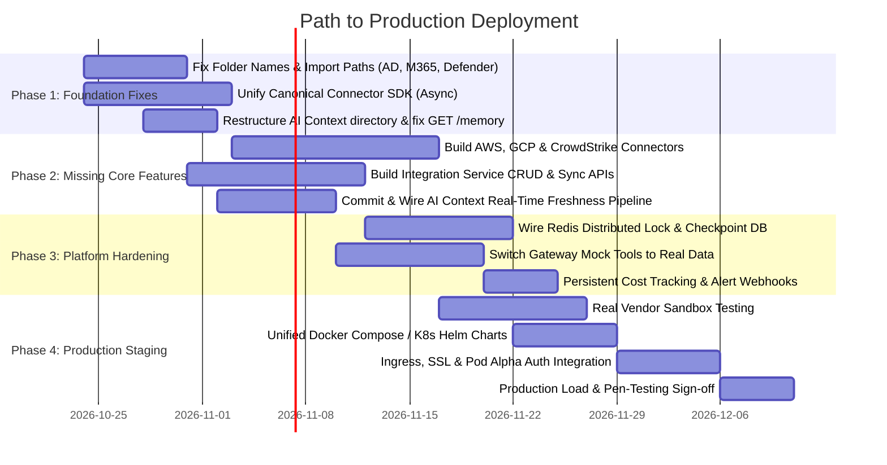

# AEV Platform – Pod Delta (Module 4 Backend)
## Gap Analysis, Improvement Roadmap & Deployment Readiness Assessment

> **Reference Documents:** 
> - `AEV Platform – Module 4 Backend What We Built, Explained Simply.docx`
> - `architecture.md` (Pod Delta System Architecture)
> - Current Repository Codebase (`develop` branch / local state: 1,088 files)
>
> **Prepared for:** Engineering Leadership, Product Leads & Squad Engineers  
> **Date:** October 2026

---

## Executive Summary & Completion Scorecard

The Pod Delta backend comprises four engineering squads responsible for the **Experience Layer** and **Security Integration Hub** of the Adversarial Exposure Validation (AEV) platform. 

### High-Level Status: **~68% Backend Feature Complete | Alpha / Demo Ready**
- **Core Strengths:** Resilient AI Gateway with validated guardrails and fallbacks; working pgvector asset search in AI Context; robust 8-scenario Connector SDK sandbox; 19 coded connectors with strong mock suites.
- **Production Blockers:** Mismatched SDK contracts; broken Python package imports due to hyphens in folder names; in-memory locks/state (non-distributed); integration management endpoints unbuilt; 3 missing enterprise connectors (AWS, GCP, CrowdStrike); zero live-vendor sandbox testing; and lack of an auth proxy / unified ingress.

```
┌───────────────────────────┬──────────────┬──────────────────┬────────────────────────┐
│ Squad / Domain            │ Completion % │ Production Ready │ Primary Focus          │
├───────────────────────────┼──────────────┼──────────────────┼────────────────────────┤
│ 1. AI Gateway             │ 82%          │ Amber (Staging)  │ Real tool data & auth  │
│ 2. AI Context             │ 70%          │ Amber (Staging)  │ Freshness pipeline     │
│ 3. Connector SDK          │ 75%          │ Amber (Staging)  │ Single canonical SDK   │
│ 4. Integration Hub        │ 62%          │ Red (Alpha only) │ Folder names, API & DB │
│ 5. Shared Infra & Ingress │ 35%          │ Red (Incomplete) │ Ingress, Auth & Redis  │
│ 6. Web Frontend           │ 0%           │ Not Started      │ External dependency    │
├───────────────────────────┼──────────────┼──────────────────┼────────────────────────┤
│ Overall Pod Delta Backend │ 68%          │ Alpha / Lab Only │ ~6–8 Weeks to Prod     │
└───────────────────────────┴──────────────┴──────────────────┴────────────────────────┘
```

---

## Detailed Squad Breakdown: What is Left & What Needs Updating

---

### 1. AI Gateway Squad (Lead: Hansika Malik)
*Status: 82% Complete · 262 unit tests passing · Strong guardrails (40/40 & 25/25 blocked) · 3-level fallback*

#### What is Left to Build:
1. **Dynamic Tool Calling by LLM Reasoning:**
   - *Current state:* The gateway only executes `risk_score_get` automatically via a regex check when an `asset-XXX` token appears in the query. The other 7 tools (`asset_search`, `exposure_query`, `report_generate`, `workflow_assist`, `policy_check`, `audit_query`, `integration_list`) are wired only through manual dispatcher calls.
   - *Required:* Enable Gemma / function calling or prompt-guided tool dispatch so the AI autonomously determines which tools to invoke based on user intent.
2. **Real Sources on Answers:**
   - *Current state:* Model answers default to placeholder citation documents (`doc_123`, `example.com`).
   - *Required:* Bind dynamic citations directly from actual tool execution responses and vector search hits from the AI Context service.
3. **Knowledge Base (KB) Article Tool:**
   - *Current state:* KB articles are defined as a valid citation source type, but no backing retrieval tool exists.

#### What Needs Improvement / Updating:
1. **Live Data Integration (Replace Mocks):**
   - In `app/mock_data.py` and `app/mock_tools.py`, replace static asset/risk dictionaries with actual RPC/REST clients connecting to Pod Alpha / Pod Beta data stores.
2. **Persistent Spend Tracking Across Restarts:**
   - `CostTracker._org_spend` is currently stored in an in-memory dictionary. A container reboot resets spending to $0.00.
   - *Update:* Run SQL aggregation queries on the `ai_interactions` table (`SELECT SUM(cost) WHERE org_id = ...`) or cache aggregates in Redis. Add `org_id` column to migration schemas.
3. **Alert Webhook Destination:**
   - Budget threshold alerts (80%, 100%) and fallback rate-spike alerts currently only write to standard Python loggers.
   - *Update:* Wire `ALERT_WEBHOOK_URL` to send real-time notifications to Slack, PagerDuty, or Microsoft Teams.
4. **Authentication & Trust Boundaries:**
   - The Gateway accepts `X-User-ID` and `X-User-Role` without validating cryptographic signatures or tokens.
   - *Update:* Add JWT validation middleware or enforce mutual TLS / internal network isolation so only Pod Alpha can set these headers.

---

### 2. AI Context Squad (Lead: Shanmukha Satya Yandra)
*Status: 70% Complete · pgvector 384-dim asset search operational · User memory CRUD working*

#### What is Left to Build:
1. **Real-Time Data Freshness Event Pipeline:**
   - *Missing in Repo:* The Week 4 progress report outlines an event-driven pipeline that reacts to `AssetUpdated`, `ExposureDetected`, and `RiskCalculated` events and recomputes vector embeddings within 60 seconds. This code has **not yet been committed** to the repository.
   - *Required:* Integrate Kafka / Redis Streams / Webhook listener that ingests asset lifecycle events and triggers `generate_asset_embeddings.py`.
2. **Specialized Security AI Endpoints:**
   - Templates for *Exposure Explanation*, *Remediation Planning*, *Executive Summary*, and *Security Recommendations* exist, but the service lacks dedicated endpoint routes to expose them.

#### What Needs Improvement / Updating:
1. **Critical Privacy & Isolation Fix (Security Issue):**
   - The `GET /memory` endpoint currently returns **all** memories across all users without user or tenant filtering.
   - *Update:* Restrict `GET /memory` to administrators only, or remove it entirely in favor of `GET /memory/user/{user_id}`.
2. **Repository & Directory Structure Clean-up:**
   - The primary codebase sits under an unpolished path: `backend/ai-context/CODES/AEV_AI_CONTEXT - Copy/`.
   - *Update:* Move code to `backend/ai-context/app/`, delete the `- Copy` folder, write a complete `README.md`, and clean up UTF-16 / Windows encoding quirks in `requirements.txt`.
3. **Port Conflicts:**
   - Default `docker-compose.yml` binds to port `8001`, which directly conflicts with the AI Gateway when running locally on the same host. Change default port to `8002`.

---

### 3. Connector SDK Squad (Lead: Likith TV)
*Status: 75% Complete · 6-method contract defined · 8-scenario sandbox · Trivy image scanning*

#### What is Left to Build:
1. **Python SDK Distribution Package:**
   - *Current state:* Connectors import local files or copy-paste models.
   - *Required:* Package `connector_sdk` into an installable wheel / internal PyPI package (`pip install aev-connector-sdk`) with minimal production dependencies.
2. **Persistent Custom Connector Registry:**
   - *Current state:* `POST /connectors/custom` stores registered connector images in an in-memory dictionary.
   - *Required:* Back the registry with PostgreSQL or Redis, and add RBAC + audit logging for who registered which container image.
3. **TypeScript Sandbox Feature Parity:**
   - The Python sandbox fake vendor supports all 8 failure scenarios and latency simulation; the TypeScript fake vendor cannot yet simulate granular network errors or timeout delays.

#### What Needs Improvement / Updating:
1. **Contract Dual-Version Reconciliation (High Priority Tech Debt):**
   - Two diverging contracts exist in the repository:
     - Version A: Week 1 SDK (`backend/connector-sdk/connector_sdk`) with synchronous `sync()`.
     - Version B: Integration version (`backend/integration/...`) with `async def sync()` and camelCase vs snake_case mismatches (`discovered_at` vs `discoveredAt`).
   - *Update:* Formally deprecate Version A, standardize on the asynchronous `async def sync()`, freeze the contract, and migrate all connectors to it.
2. **Update Security Documentation:**
   - Older markdown notes state that container vulnerability scanning is "not implemented", whereas Trivy scanning is now integrated into `registration.py`. Docs need updating.

---

### 4. Integration Squad (Lead: Harshal Sahare)
*Status: 62% Complete · 19 of 22 connectors written · Shared Vault client & hardened sync engine*

#### What is Left to Build:
1. **Three Missing Connectors:**
   - **AWS Connector:** EC2, S3, IAM, RDS, and Lambda discovery.
   - **Google Cloud Platform (GCP) Connector:** Compute Engine, Cloud Storage, IAM, Cloud SQL.
   - **CrowdStrike Falcon Connector:** Endpoint threat detections and asset telemetry.
2. **Integration Service Management API (20 Endpoints Missing):**
   - The platform specification requires an orchestration REST API to manage connectors:
     - `POST /integrations` (Configure & enable connector)
     - `GET /integrations` & `GET /integrations/{id}` (Status, stats)
     - `POST /integrations/{id}/sync` (Trigger manual sync)
     - `POST /integrations/{id}/test` (Run live health check)
     - `PATCH /integrations/{id}/disable` (Pause sync schedules)
     - `GET /integrations/{id}/history` (View past sync jobs)
   - *Current state:* `backend/integration/integration-service` contains only `GET /health` and a contract test stub.
3. **Database Schema & Migrations:**
   - Missing SQL schemas for `integrations` (configs, encrypted credentials, schedules) and `sync_jobs` (execution runs, asset counts, error logs).

#### What Needs Improvement / Updating:
1. **Fix Broken Test Suites Due to Folder Naming (Immediate Blocker):**
   - Connectors with hyphenated directory names cannot be cleanly imported in Python test suites:
     - `backend/integration/microsoft365-connector/`
     - `backend/integration/active-directory-connector/`
     - `backend/integration/microsoft-defender-connector/`
     - `backend/integration/google-workspace-connector/`
     - `backend/integration/cyberark-discovery-integration/`
   - *Fix:* Standardize directories to use underscores (e.g. `microsoft365_connector`) or configure proper `PYTHONPATH` package root resolution in `pyproject.toml`.
2. **Fix Failing Jira Connector Tests:**
   - 2 of 13 tests currently fail because the Jira connector was made `async`, while the unit tests still await a synchronous return value.
3. **Replace In-Memory Lock with Redis Distributed Lock:**
   - The current `HardenedSyncEngine` uses a local `threading.Lock`. If the integration service scales to multiple worker pods/containers, concurrent syncs will collide.
   - *Fix:* Wire the engine to the existing `shared_infra/src/distributed_lock.py` backed by Redis.
4. **Implement True Incremental Sync (Delta Sync):**
   - Checkpoints are currently stored as local JSON files (`test_checkpoint.json`), and connectors pull full batches rather than requesting only delta changes (`since_timestamp` or change tokens) from third-party APIs.
5. **Real Stand-Ins for Regression Suite:**
   - The "21 connectors" regression suite relies heavily on mock stand-ins that hardcode `status: success`. Real connectors must be wired into the regression runner.
6. **Live Vendor Sandbox Trials:**
   - All 19 connectors have only been tested against simulated mocks. Staging validation against real vendor developer accounts (e.g., Azure Sandbox, Jira Cloud Dev instance, GitHub App) is required.

---

### 5. Cross-Cutting Systems & Deployment Readiness

#### Missing Components:
1. **Unified Docker Compose / Kubernetes Manifests:**
   - Individual sub-services have Dockerfiles, but there is no top-level `docker-compose.yml` or Helm chart orchestrating Gateway, Context, Integration Service, Postgres, and Redis together with unified networking and secrets.
2. **Central Ingress / API Gateway:**
   - No reverse proxy (e.g., NGINX, Traefik, Envoy) exists to route public traffic (`/api/v1/copilot` -> AI Gateway :8001, `/api/v1/context` -> AI Context :8002, `/api/v1/integrations` -> Integration Service :8000).
3. **Shared Directory Implementation:**
   - The root `/shared` folder (`config`, `models`, `schemas`, `types`, `utils`) contains only empty placeholder README files. Shared schemas should be consolidated here.
4. **Web Frontend:**
   - `frontend/` is an empty placeholder. While Pod Delta is primarily backend-focused, any internal administrator UI or Copilot web interface must be linked or supplied by external squads.

---

## Deployment Readiness: How Far Are We?

### Estimated Time to Production: **6 to 8 Weeks**



---

## Prioritized Action Plan (The Next Sprints)

### Sprint 1: Quick Wins & Blocker Removal (Week 1–2)
- [ ] **Fix Directory Names:** Rename hyphenated directories in `backend/integration/` to valid Python package names (e.g. `microsoft365_connector`).
- [ ] **Fix Jira Connector Tests:** Update `tests/test_jira_connector.py` to support `async def sync()`.
- [ ] **Lock Down Privacy Hole:** Remove or restrict `GET /memory` in AI Context.
- [ ] **Folder Clean-up:** Relocate `backend/ai-context/CODES/AEV_AI_CONTEXT - Copy/` to clean production directory structure.
- [ ] **Contract Freeze:** Adopt the asynchronous SDK as the single canonical standard; deprecate duplicate local base classes.

### Sprint 2: Core Capability Delivery (Week 3–4)
- [ ] **Missing Connectors:** Implement AWS and GCP cloud asset discovery; build CrowdStrike Falcon detection ingestion.
- [ ] **Integration Service API:** Implement the ~20 connector management endpoints (`POST /integrations`, `POST /sync`, `GET /status`) backed by PostgreSQL.
- [ ] **Commit Freshness Pipeline:** Merge and verify the 60-second real-time vector re-indexing pipeline in AI Context.

### Sprint 3: Enterprise Hardening (Week 5–6)
- [ ] **Distributed Infrastructure:** Switch sync engine lock from in-memory to Redis; store sync checkpoints in PostgreSQL.
- [ ] **Live Tool Data:** Connect AI Gateway tools to live integration feeds rather than `mock_data.py`.
- [ ] **Spend & Alerting:** Add DB-backed cost calculation and configure Slack/PagerDuty webhook alerts.

### Sprint 4: Integration, Ingress & Deployment (Week 7–8)
- [ ] **Sandbox Trials:** Execute live end-to-end syncs with real developer accounts for Azure, GitHub, Okta, and Jira.
- [ ] **Unified Orchestration:** Create unified root Docker Compose and Kubernetes Helm charts.
- [ ] **Security Integration:** Put AI Gateway and Integration Service behind Pod Alpha API Gateway / JWT validation.
- [ ] **Final Sign-off:** Run disaster recovery tests, credential rotation validation, and pen-testing probes.
